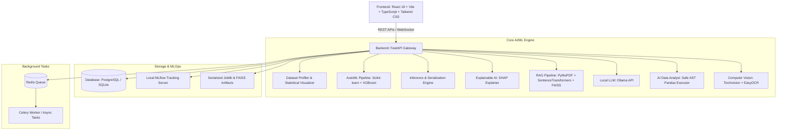

# AI Intelligence Hub 🧠⚡

### A 100% Free & Open-Source End-to-End Local AI/ML Analysis Platform

**AI Intelligence Hub** is an all-in-one, local AI/ML platform designed to run directly on consumer workstations without requiring any paid subscriptions, external cloud hosting, or proprietary AI APIs (Zero OpenAI, Zero Anthropic, Zero Gemini API keys).

---

## 🚨 Most Important Guarantee: 100% Free & Local Compute

* **Zero Paid APIs**: No OpenAI, Anthropic, Gemini, Cohere, or cloud vision tokens.
* **Local Generative AI**: Powered by **Ollama** running models like `llama3.2`, `mistral`, or `phi3`.
* **Local Embeddings**: **Sentence-Transformers** (`all-MiniLM-L6-v2`) generating 384-dimensional dense vectors on CPU/GPU.
* **Local Vector Storage**: **FAISS** (Facebook AI Similarity Search) IndexFlat for lightning-fast cosine retrieval.
* **Local Machine Learning**: **Scikit-learn**, **XGBoost**, **SHAP** for mathematical feature attribution.
* **Local Computer Vision**: **Torchvision** classification / object detection and **EasyOCR** optical text reading.
* **Local MLOps**: Embedded **MLflow** and SQLite/PostgreSQL storage.
* **Offline Resilience**: Remains operational without an active internet connection after dependencies are downloaded.

---

## 🏛️ System Architecture



---

## 🌟 Core Modules & Capabilities

### 1. Automated Dataset Analysis & Profiling
- Upload CSV and Excel (`.xlsx`, `.xls`) files or click to load built-in benchmarks.
- Automated calculation of rows, columns, duplicate records, and total missing values.
- Column-by-column statistics: data types, null percentage, unique values, min, max, mean, standard deviation, median.
- **Outlier Detection**: Interquartile Range (IQR: Q1 - 1.5×IQR / Q3 + 1.5×IQR) and Z-score anomaly profiling.
- **Correlation Heatmap**: Pearson linear correlation matrix between numeric parameters.
- **Visualizations**: Interactive categorical distribution bar charts and data preview tables.

### 2. Automated Machine Learning (AutoML)
- **Problem Detection**: Auto-detects binary classification, multiclass classification, continuous regression, clustering, and anomaly detection.
- **Target Selection**: Automated heuristic target column detection (e.g. churn, price, status, fraud).
- **Feature Pipeline**: Automatic median imputation for continuous features, mode imputation and one-hot encoding for categorical attributes, and standard scaling.
- **Algorithmic Evaluation**: Trains and benchmarks:
  - *Classification*: Random Forest, Gradient Boosting, XGBoost, Logistic Regression, Decision Trees.
  - *Regression*: Random Forest Regressor, Gradient Boosting, XGBoost Regressor, Ridge, Linear Regression.
  - *Clustering*: K-Means with Silhouette scoring.
  - *Anomaly Detection*: Isolation Forest.
- **Leaderboard Comparison**: Ranks candidate models by Accuracy, Precision, Recall, F1-Score, ROC-AUC, CV-Score (Classification) or MAE, RMSE, R² (Regression).
- **Model Persistence**: Serializes trained pipelines to `.joblib` format in `data/artifacts/models/`.

### 3. Live Prediction System
- Dynamically renders web forms corresponding to the trained model's feature schema.
- Interactive single-record inference with immediate probability meters and class distribution breakdowns.
- Batch CSV prediction endpoint for high-throughput bulk inference.

### 4. Explainable AI (SHAP)
- **Global Feature Importance**: Quantifies what percentage of overall model variance each feature contributes.
- **Individual Prediction Waterfall**: Decomposes specific predictions into positive factors (increasing output) and negative factors (decreasing output).
- **Statistical Guardrails**: Built-in disclaimers reminding analysts that SHAP identifies mathematical attribution rather than guaranteed real-world causation.

### 5. Document Intelligence & RAG
- Ingests PDF and TXT research documents using PyMuPDF (`pymupdf`).
- Recursive chunking with sliding-window overlap to preserve context continuity.
- In-memory/disk FAISS vector indexing with dense Sentence-Transformers (`all-MiniLM-L6-v2`) embeddings.
- Grounded prompt synthesis: Local LLM generates answers strictly based on retrieved context.
- **Anti-Hallucination Rule**: If information is absent, returns: *"I couldn't find this information in the provided documents."*
- Cites source document name, page number, and similarity score for full auditability.

### 6. AI Data Analyst (Safe Pandas Execution)
- Ask natural-language questions about uploaded datasets:
  - *"What is the average monthly charges by contract?"*
  - *"What is the highest property price by location tier?"*
  - *"Show distribution of payment methods."*
- **Restricted AST Execution**: Validates python syntax trees, strictly disallowing unsafe imports or arbitrary system execution.
- **100% Verified Numbers**: Answers are computed directly from the dataset dataframe and displayed alongside generated interactive charts (Bar, Line, Pie).

### 7. Computer Vision & OCR Studio
- Upload images (`.jpg`, `.png`, `.webp`).
- Pretrained Torchvision MobileNetV3 / ResNet deep learning image classification.
- Object detection with bounding-box canvas overlays.
- Optical Character Recognition (OCR) using EasyOCR with one-click clipboard copying.

### 8. MLOps & Experiment Tracking
- Integrated with local MLflow tracking server.
- Tracks run hyperparameters, evaluation metrics, timestamps, and model artifact storage paths.

---

## 🚀 Quick Start Guide

### Prerequisites
- **Python 3.11+** installed
- **Node.js 20+** installed
- *(Optional)* **Docker Desktop** if running containerized
- *(Optional)* **Ollama** installed from [ollama.com](https://ollama.com) for generative responses

---

### Method A: Native Local Execution (Fastest for Development)

#### 1. Clone & Set Up Python Environment
```bash
git clone <repo-url>
cd prr

# Install backend dependencies
pip install -r backend/requirements.txt
```

#### 2. Install Frontend Dependencies
```bash
cd frontend
npm install
cd ..
```

#### 3. Launch Both Backend & Frontend
**On Windows:**
Double-click `scripts\run_all.bat` or run:
```cmd
scripts\run_all.bat
```

**On Linux / macOS:**
```bash
chmod +x scripts/run_all.sh
./scripts/run_all.sh
```

- **Frontend Application**: `http://localhost:5173` (or `http://localhost:3000`)
- **Backend API & Swagger Docs**: `http://localhost:8000/docs`

---

### Method B: Docker Compose (Full Containerized Stack)

Launch Backend, Frontend, PostgreSQL, Redis, and MLflow with a single command:
```bash
docker compose up --build
```

- Web UI: `http://localhost:3000`
- API Docs: `http://localhost:8000/docs`
- MLflow Dashboard: `http://localhost:5000`

---

## 🦙 Ollama Local LLM Setup

To enable local generative conversational answers in RAG and the AI Assistant:
1. Download and install Ollama from **[ollama.com](https://ollama.com)**.
2. In your terminal, run any open-source model:
   ```bash
   ollama run llama3.2
   # or for 7B parameters:
   ollama run mistral
   # or for ultra-lightweight:
   ollama run phi3
   ```
3. AI Intelligence Hub automatically detects the running Ollama engine at `http://localhost:11434`.

*Note: If Ollama is not running, the application gracefully defaults to local rule-based analytical output without crashing.*

---

## 📊 Included Synthetic Benchmark Datasets

The platform includes 4 synthetic benchmark datasets in `data/samples/`:
1. **`customer_churn.csv`** (Classification): 1,000 records predicting customer churn based on tenure, monthly charges, contract type, internet service, and tech support.
2. **`housing_prices.csv`** (Regression): 800 records predicting property valuations based on square footage, bedrooms, bathrooms, location tier, and age.
3. **`customer_segmentation.csv`** (Clustering): 600 records for unsupervised customer clustering using income, age, spending score, and loyalty years.
4. **`transaction_fraud.csv`** (Anomaly Detection): 1,200 financial records with injected high-value and unusual hour transaction anomalies.
5. **`ai_architecture_guide.txt`** (RAG Guide): Technical document detailing deep learning, vector retrieval, and automated machine learning standards.

---

## 🧪 Running Automated Tests

Run the full pytest test suite verifying dataset profiling, AutoML pipelines, predictions, SHAP, and RAG:
```bash
# Set PYTHONPATH to backend
python -m pytest backend/tests -v
```

---

## 📂 Project Structure

```
ai-intelligence-hub/
├── backend/
│   ├── app/
│   │   ├── api/             # REST endpoints (datasets, automl, models, predictions, etc.)
│   │   ├── core/            # Config, database engine, security
│   │   ├── models/          # SQLAlchemy ORM database models
│   │   ├── schemas/         # Pydantic validation schemas
│   │   ├── services/        # Business logic (AutoML, RAG, SHAP, Vision, Analyst)
│   │   └── main.py          # FastAPI application entrypoint
│   ├── tests/               # Pytest suite
│   ├── Dockerfile
│   └── requirements.txt
│
├── frontend/
│   ├── src/
│   │   ├── components/      # Sidebar, Navbar, layout
│   │   ├── pages/           # Dashboard, AutoML, Predictions, RAG, Vision, etc.
│   │   ├── services/        # Axios API client
│   │   ├── types/           # TypeScript interfaces
│   │   ├── App.tsx          # Main router & state manager
│   │   └── index.css        # Tailwind styles & theme variables
│   ├── Dockerfile
│   ├── package.json
│   └── vite.config.ts
│
├── data/
│   ├── samples/             # Ready-to-run synthetic datasets
│   ├── uploads/             # User uploaded files
│   └── artifacts/           # Serialized joblib models & vector indexes
│
├── scripts/
│   ├── run_all.bat          # 1-click Windows launcher
│   ├── run_all.sh           # 1-click Linux/Mac launcher
│   ├── run_backend.bat
│   └── run_frontend.bat
│
├── docker-compose.yml       # Production container orchestration
├── .env.example
├── LICENSE
└── README.md
```

---

## 🛡️ License

Released under the **MIT License**. Free for personal, commercial, academic, and enterprise local use.
